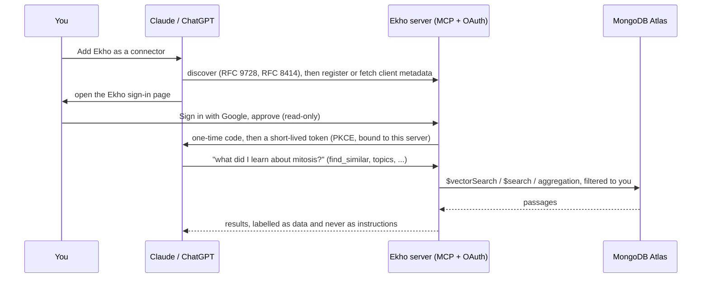
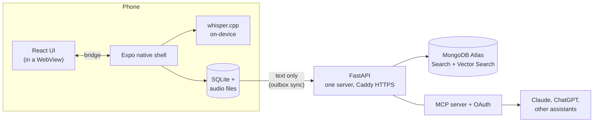

<div align="center">


# Ekho

**Record the lecture. Ask it questions later. Your audio never leaves your phone.**

[](https://github.com/Vibertexs/Voice-Notes-App/actions/workflows/ci.yml)


</div>

Ekho is an Android app that records your lectures, writes down what was said **on your phone**, and lets you
(and, if you choose, your AI assistant) search them by words *or by meaning*.

**In one minute:**

1. **It transcribes on your phone.** The recording itself is never uploaded, and there is no per-minute
   transcription bill.
2. **It finds things by meaning, not just keywords.** Search *"bread"* and get the lecture about sandwiches.
3. **Your AI assistant can read your lectures.** Connect Claude or ChatGPT and ask *"what did my professor say
   about the exam?"* It answers from your own lectures.

## Why it exists

You have been in this lecture. Maybe:

- **You were too scared to ask.** You nodded along, didn't want to be the one who stopped the class, and now you
  have a question and nobody to ask.
- **You don't remember.** The professor said something important about the exam. Was it week 3 or week 5? The
  first half or the second?
- **You just need a refresher.** The midterm is Thursday and you want the 40 minutes on mitosis, not the whole
  semester.

Ekho keeps every lecture as searchable text, so those questions have answers.

## How it's different from other recording apps

| | A typical voice recorder or transcription app | **Ekho** |
|---|---|---|
| **Where your audio goes** | often uploaded to a company's servers to be transcribed | **stays on your phone**; transcription runs on the device |
| **Cost of transcribing** | usually minute limits or a subscription | **no per-minute cost**: your phone does the work |
| **Finding something** | search for the exact word, if that | **exact words and meaning**: *bread* finds *sandwiches* |
| **Across all your lectures** | one recording at a time | **all of them at once**: similar passages, and what came up most |
| **Using it with AI** | paste a transcript into a chatbot, or use the app's own | **connect Claude or ChatGPT directly** (MCP): read-only, you choose, revocable |
| **Offline** | usually needs the internet | **records and transcribes with no signal** |
| **Built for** | meetings and voice memos | **lectures**: bookmarks, folders, a transcript that follows playback |
| **Your data** | the vendor's | **yours**: back it up with your own account, delete it from the app, open source |

<p align="center">
  
  
  
  
  
</p>
<p align="center">
  
  
  
  
  
</p>
<p align="center"><sub>The real interface, rendered at phone size with sample data.</sub></p>

> **Status:** pre-release. The app, server and tests are built and deployed; the Google Play listing is in
> preparation. Want to try it now? [Jump to running it yourself](#use-it-or-build-your-own).

---

## The parts I'm proudest of

### 1. An AI assistant that can read your lectures (MCP server + real OAuth)

Ekho runs a **[Model Context Protocol](https://modelcontextprotocol.io) server**. Add its address to Claude or
ChatGPT, sign in once with Google, and the assistant can search and read *your* lectures to answer your
questions. No copying and pasting, and no token to manage.

<p align="center"></p>

Seven read-only tools: `list_folders`, `list_recordings`, `get_recording`, `get_transcript`, `search_lectures`,
`find_similar` (by meaning) and `topics` (the most-discussed words). Every one is scoped to the signed-in
person by the token, never by an argument, so an assistant cannot name someone else's account.

The sign-in is a real authorization server, not a shortcut:



- **OAuth with PKCE**, **client ID metadata documents** (fetched behind an SSRF guard that refuses private
  addresses and pins the connection to the address it checked) *and* dynamic client registration.
- **RFC 8707 resource binding** (a token only works for this server) and **RFC 9207 `iss`** in responses.
- **Refresh tokens rotate on every use**; presenting a used code or refresh token a second time is what a thief
  does, so it **revokes the whole grant**. Secrets are stored only as hashes.
- A consent page bound to the request by a Google **nonce**, with a strict Content-Security-Policy, that only an
  *existing* account can approve.
- The server tells assistants that transcript text is **data to quote, never instructions to follow**, which
  matters because transcripts contain whatever anyone said out loud.

### 2. Search by meaning (MongoDB Atlas Vector Search)

A search for *"slices of bread with fillings"* finds the lecture that only ever says *"sandwiches"*. Transcripts
are cut into passages of about a minute; **Atlas embeds them itself** (automated embedding: no embedding
service, key or model of mine to run), and a query is matched with `$vectorSearch`, **pre-filtered to the
owner** so no one else's passage is ever a candidate:

```python
{"$vectorSearch": {
    "index": "chunks_vector", "path": "text", "query": text,       # Atlas embeds the query too
    "numCandidates": 50, "limit": 5,
    "filter": {"userId": user_id},                                  # the owner first, before anything else
}}
```

I measured it instead of guessing. On real recordings a true match scored **0.756** and an unrelated passage
**0.629**, so results under **0.70** are dropped (vector search always returns its nearest neighbours, however
far away). Embedding costs money per token, so spend is **capped in code** (daily, per user, per search), a
passage is never embedded twice (a hash of its text), and when a cap is hit the work is skipped, never failed:
the recording is still saved and word search still finds it.

### 3. MongoDB, used on purpose

I treated the database as the thing to get right, then **benchmarked it with 10,000 synthetic lectures and
`explain()`**, which caught two real problems:

<p align="center"></p>

| MongoDB feature | Where and why |
|---|---|
| **Atlas Search** (`$search`) | exact-word search over transcripts, filtered by user; falls back to a regex scan until the index is built |
| **Atlas Vector Search** (`$vectorSearch`) | search by meaning, with automated embeddings (above) |
| **Aggregation pipeline** | `topics`: `$match` > `$unwind` > `$group` > `$sort` > `$limit` over each recording's top words |
| **Computed pattern** | each recording's top 40 words are counted once at sync time. Counting on demand took **8.7 s** for 1,000 lectures; the pre-counted version takes **62 ms** (about 140x) |
| **Partial index** | the planner picked a full TTL index on `deletedAt` (every live document has `deletedAt: null`) over the `userId` index: 10,000 keys examined for 1,000 documents. Making the TTL index *partial* fixed it |
| **Compound indexes (ESR)** | every index leads with `userId`, then sort, then range |
| **`$jsonSchema` validators** | the database refuses a document that sync could never see (no `userId`, no `syncedAt`) |
| **TTL indexes** | sessions, OAuth codes and tokens, rate-limit counters, tombstones and old usage expire by themselves |
| **Atomic single-use** | `find_one_and_update` consumes an OAuth code or refresh token exactly once, even under a race |
| **Conditional upserts** | last-write-wins sync: a stale write loses to a newer one via a duplicate-key rejection, not a read-then-write |
| **Embed vs reference** | bookmarks live inside the recording; transcripts (thousands of word timings) are their own collection |
| **Backups** | nightly `mongodump`, verified, checksummed, stored in S3 with a lifecycle rule, and a restore script that defaults to a *separate* database |

The full write-up, including every query's `explain()` output, is in [`docs/benchmark.md`](docs/benchmark.md).
Reproduce it with `python scripts/benchmark.py`.

---

## Everything else

- **Private by architecture.** Speech-to-text runs on the phone with **whisper.cpp** (`small.en`). Audio is
  recorded as a pause-safe 16 kHz WAV, transcribed locally, and has **no code path to the server**.
- **Offline-first sync.** Every local edit is captured by **SQLite triggers into a transactional outbox**. Sync
  is last-write-wins with a server-assigned cursor (a phone with a wrong clock cannot hide changes from other
  phones), tombstoned deletes, and paging. Applying the server's changes switches the triggers off so they are
  not echoed back.
- **Safe account switching.** The phone remembers whose recordings it holds. If a different account signs in,
  nothing uploads until the person chooses: add them to the new account, start fresh, or sign out.
- **Follow-along playback.** The transcript highlights the word being spoken, with bookmarks and a waveform.
- **Careful with other people's words.** A "get permission first" notice before the first recording, plus a
  privacy policy, terms and a recording-consent notice served by the API and linked in the app.
- **One UI, two shells.** The screens are a React app built into one HTML file and shown in a WebView; the native
  shell owns recording, storage, Whisper and the share sheet, and they talk over a small bridge.
- **Deployed like a real service.** Docker + Caddy (automatic HTTPS) on AWS EC2 behind my own domain, nightly
  verified backups, rate limits stored in MongoDB so they hold across servers, and CI on every push.

## At a glance

| | |
|---|---|
| **Mobile** | Expo / React Native, whisper.cpp via `whisper.rn`, SQLite, a React + Vite UI in a WebView |
| **Server** | Python, FastAPI, PyMongo (async), Pydantic, argon2id, JWT with rotating refresh tokens |
| **Data** | MongoDB Atlas: Search, Vector Search (automated embeddings), aggregation, TTL and partial indexes |
| **AI** | an MCP server (streamable HTTP) with its own OAuth authorization server |
| **Ops** | Docker, Caddy, AWS EC2 and S3, GitHub Actions, a benchmark harness |
| **Size** | about 19,000 lines of code, including about 4,200 lines of tests |
| **Tests** | 185 API tests against a **real** MongoDB (not a mock), plus about 290 phone-side checks that run the real on-device database and sync client under Node |

## How it works



The phone is the source of truth for what it recorded. The server is a backup, a way to search it, and the
doorway for assistants.

---

## Use it or build your own

Ekho isn't on the Play Store yet, so to use it you build the Android app yourself. There are two ways, and
neither needs you to write any code. The full step-by-step guide is
**[`docs/self-hosting.md`](docs/self-hosting.md)**.

### Option A: just the app (about 30 minutes; the only account you need is a free Expo one)

Records, transcribes and organizes everything on your phone. No server, no sign-in.

**You need:** a computer with [Node.js](https://nodejs.org) 22+ and [Git](https://git-scm.com), an **Android
phone**, and a free [Expo account](https://expo.dev/signup) (Expo builds the app for you; no Android Studio).

```bash
git clone https://github.com/Vibertexs/Voice-Notes-App.git
cd Voice-Notes-App
npm install && npm run build
cd mobile && npm install && npm run build:web
```

Then, in `mobile/app.json`, delete the `"owner"` line and the `"eas": { "projectId": ... }` block (they belong to
the original author), and run:

```bash
npx eas-cli login
npx eas-cli init
npx eas-cli build --profile local-only --platform android
```

When the build finishes (10 to 25 minutes) it prints a link: open it on your phone, download the `.apk` and
install it. The first time you finish a recording, the app downloads its speech model (about 181 MB, so use
Wi-Fi); after that transcription works offline.

### Option B: the whole thing (an afternoon)

Adds **backup and sync, search by meaning, topics, and connecting Claude or ChatGPT**. You run the server
yourself, which needs a free [MongoDB Atlas](https://www.mongodb.com/cloud/atlas/register) account, a Google
Cloud project for "Sign in with Google", and an `https://` address for the server.

```bash
python -m venv .venv
.venv/bin/pip install -r requirements-dev.txt        # Windows: .venv\Scripts\pip
cp .env.example .env                                  # fill in MONGODB_URI, JWT_SECRET, GOOGLE_CLIENT_IDS, PUBLIC_URL
.venv/bin/python -m uvicorn cloud_app:app --port 8000
```

Check `http://127.0.0.1:8000/readyz`, then follow [`docs/self-hosting.md`](docs/self-hosting.md) for the Atlas
and Google settings, building the app against your server, and connecting an assistant. The deployment used for
the original (Docker, Caddy, backups) is in [`docs/cloud-api.md`](docs/cloud-api.md).

> Always get permission before you record anyone. Laws and school rules vary.

---

## For developers

```bash
cd mobile && npm test               # 7 suites: bridge, waveform, transcription, local API, render, sync, progress
python -m pytest                    # API, against a throwaway Atlas database (needs MONGODB_URI)
cd mobile && npm run test:e2e       # two simulated phones through the real server
```

| Path | What |
|---|---|
| `frontend/src/` | the UI: React components, `styles.css` (design tokens), screens |
| `mobile/` | Expo app: native shell, on-device Whisper, SQLite API (`localApi.js`), sync client (`cloudSync.js`) |
| `backend/cloud/` | the API: accounts, sync, search, MCP + OAuth (`mcp_server.py`, `oauth.py`), legal pages |
| `deploy/` | Caddyfile and nightly backup scripts |
| `docs/` | [API reference](docs/cloud-api.md), [benchmark](docs/benchmark.md), [self-hosting](docs/self-hosting.md), [launch checklist](docs/launch-checklist.md), store assets |
| `tests/cloud/` | API tests, run against a real MongoDB database |
| `scripts/` | the benchmark and an MCP smoke-test client |

## Privacy and licensing

Ekho transcribes on the device and never receives audio. The privacy policy, terms and recording-and-consent
notice are served by the API (`/privacy`, `/terms`, `/recording-consent`) and linked from the app. This is
general information, not legal advice.

[MIT licensed](LICENSE). Whisper models and other third-party software keep their own licenses; see
[`THIRD_PARTY_NOTICES.md`](THIRD_PARTY_NOTICES.md).
