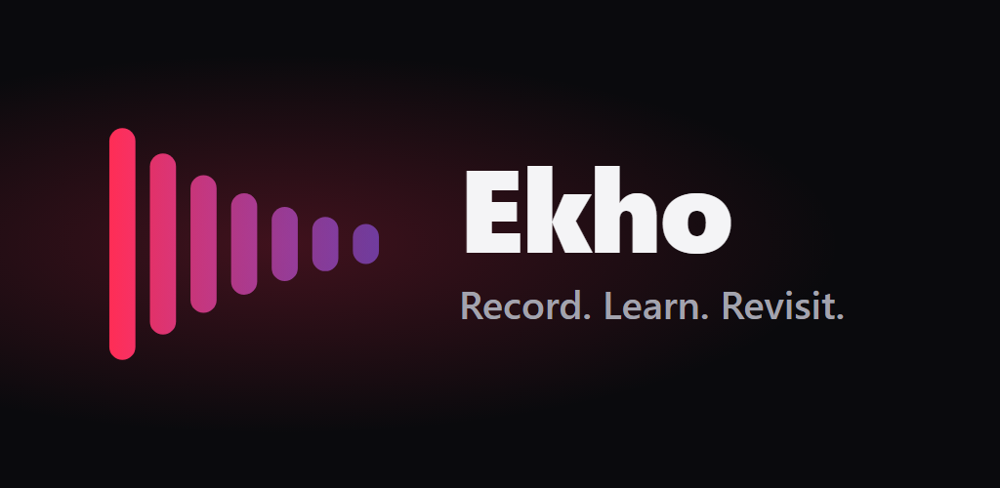
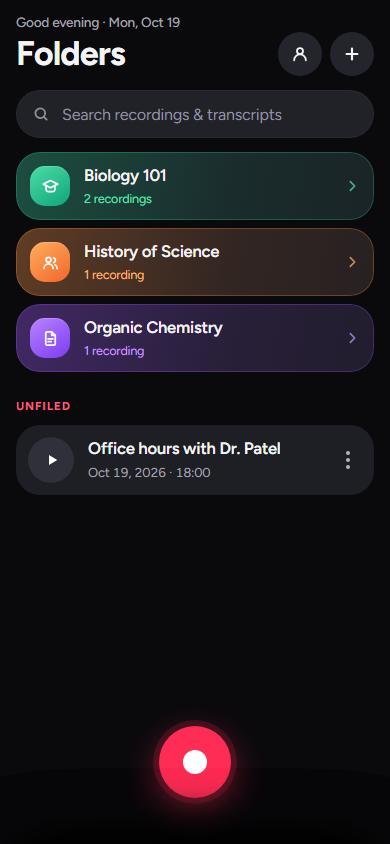
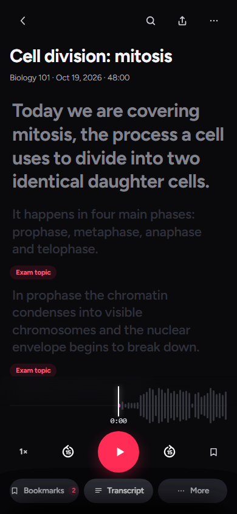
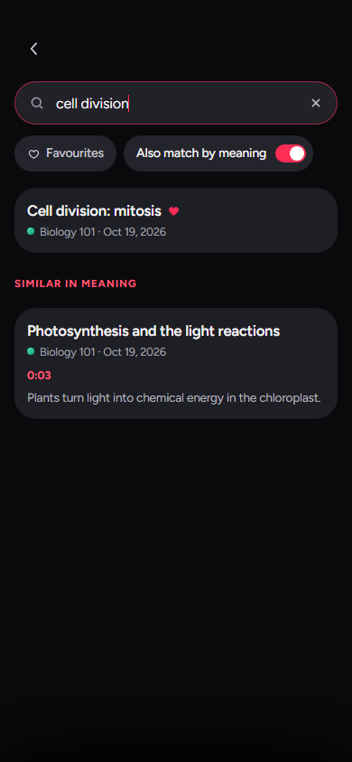
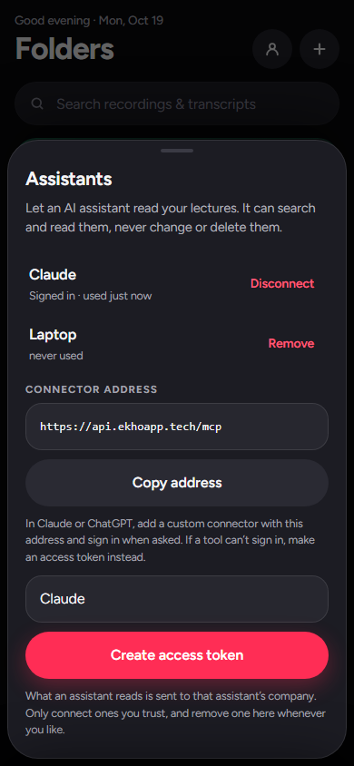
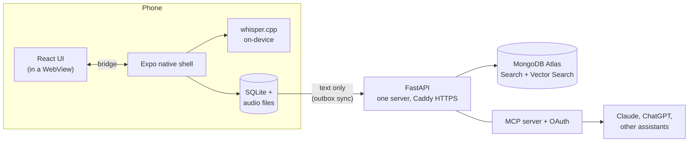

<div align="center">



# Ekho

**A lecture recorder that transcribes on your phone. Your audio never leaves it.**

[](https://github.com/Vibertexs/Voice-Notes-App/actions/workflows/ci.yml)

</div>

Ekho is an Android-first app for students. Press record in class, and the words are written
down on the device by Whisper. Later you can replay a lecture with the words highlighted as
they're spoken, search every lecture by what was said, or even by what it *meant*, and let an
AI assistant such as Claude or ChatGPT read your lectures if you choose to connect one.

<p align="center">
  
  
  
  
</p>
<p align="center"><sub>The real interface, rendered at phone size with sample data.</sub></p>

> **Status:** pre-release. The app and server are built, tested and deployed; the Google Play
> listing is in preparation.

## What it does

- **Records and transcribes on the device.** Speech-to-text runs locally with whisper.cpp
  (`small.en`). No audio is ever uploaded, and there is no per-minute transcription bill.
- **Follows along.** Playback highlights each word as it's spoken. Bookmark moments while
  recording and add your own notes.
- **Organizes.** Folders with colours and icons; search across all transcripts, with an
  optional "match by meaning" so a search for *bread* finds the lecture about sandwiches.
- **Backs up the text, not the audio.** Sign in with Google and your transcripts, titles,
  folders, bookmarks and notes sync to your account and between phones.
- **Works with your AI assistant.** Add Ekho as a connector in Claude or ChatGPT, sign in, and
  the assistant can search and read your lectures (read-only, and revocable from the app).
- **Is careful with other people's words.** A "get permission first" notice before the first
  recording, and privacy policy, terms and a recording-consent notice built in.

## How it works



The phone screen *is* a web page: `frontend/` is a React + Vite app that is built into a single
HTML file and shown in a `react-native-webview`. The native shell (`mobile/App.js`) owns
recording, file storage and Whisper, and talks to the page over a small bridge. The phone is
the source of truth for what it recorded; the server is a backup and a way to search it.

## Design decisions worth reading

**Privacy by architecture, not by policy.** Audio is recorded and transcribed on the device
and has no code path to the server. Only text and metadata sync.

**Offline-first sync.** Every local edit is captured by SQLite triggers into a transactional
outbox. Sync is last-write-wins on the edit time, with a server-assigned cursor (so a phone
with a wrong clock can't hide changes from other phones), tombstoned deletes, and paging.
Applying the server's changes switches the triggers off so they aren't echoed back.

**MongoDB, used on purpose** ([`docs/cloud-api.md`](docs/cloud-api.md),
[`docs/benchmark.md`](docs/benchmark.md)):
- *Embed what is bounded, reference what is unbounded:* bookmarks live inside the recording;
  transcripts (thousands of word timings) are their own collection.
- Every index leads with `userId` and follows ESR; each synced collection has a `$jsonSchema`
  validator, so a document that sync could never see can't be written.
- **Atlas Search** for exact words and **Atlas Vector Search** with automated embeddings for
  meaning, filtered by user before anything else, with daily and per-user cost caps in code.
- A **10,000-lecture benchmark** with `explain()` found two real problems: the planner chose a
  full `deletedAt` TTL index over the `userId` index (10,000 keys examined for 1,000 documents;
  fixed with a partial index), and counting words on demand took 8.7 s for a heavy user. Counting
  each recording's top words once at sync time (the *computed pattern*) made the same query
  about 140x faster.

**An MCP server with real OAuth.** Assistants connect over MCP (streamable HTTP). Sign-in is
OAuth with PKCE, client ID metadata documents (fetched behind an SSRF guard) or dynamic
registration, RFC 8707 resource binding, RFC 9207 `iss`, refresh-token rotation with reuse
detection that revokes the whole grant, hashed secrets, and a consent page bound to the request
by a Google nonce. Tokens are read-only and each tool is scoped to the token's user.

**Safe account switching.** The phone remembers whose recordings it holds. If a different
account signs in, nothing uploads until the person chooses to add the recordings to the new
account, start fresh, or sign out.

## Repository map

| Path | What |
|---|---|
| `frontend/src/` | the UI: React components, `styles.css` (design tokens), screens |
| `mobile/` | Expo app: native shell, on-device Whisper, SQLite API (`localApi.js`), sync client |
| `mobile/patches/` | Java fixes to the audio capture module (need a native build) |
| `backend/cloud/` | the API: accounts, sync, search, MCP + OAuth, legal pages |
| `deploy/` | Caddyfile and nightly backup scripts |
| `docs/` | API reference, benchmark, store assets, original design handoff |
| `tests/cloud/` | API tests, run against a real throwaway MongoDB database |
| `scripts/` | benchmark and an MCP smoke-test client |

## Running it

You need Node 22+, Python 3.14, and a MongoDB Atlas cluster (the free tier works).

**The API**

```bash
python -m venv .venv
.venv/bin/pip install -r requirements-dev.txt          # Windows: .venv\Scripts\pip
cp .env.example .env                                   # set MONGODB_URI at least
.venv/bin/python -m uvicorn cloud_app:app --reload     # http://127.0.0.1:8000/docs
```

**The phone UI** (the web build is inlined into the app)

```bash
npm install && npm run build
cd mobile && npm install && npm run build:web
```

The native modules (Whisper, the PCM recorder, Google sign-in) mean the app runs in an
[Expo development build](https://docs.expo.dev/develop/development-builds/introduction/), not
Expo Go: `npx eas build --profile development --platform android`, then `npx expo start`. After
that, UI changes need only `npm run build` + `npm run build:web` and a JS reload.

**Tests**

```bash
cd mobile && npm test               # 7 suites: bridge, waveform, transcription, local API, render, sync, progress
python -m pytest                    # API, against a throwaway Atlas database (needs MONGODB_URI)
cd mobile && npm run test:e2e       # two simulated phones through the real server
```

## Documentation

- [`docs/cloud-api.md`](docs/cloud-api.md): the API, data model, sync protocol, MCP and OAuth, deploy, backups
- [`docs/benchmark.md`](docs/benchmark.md): the 10,000-lecture benchmark and what it found
- [`docs/launch-checklist.md`](docs/launch-checklist.md) and [`docs/store/listing.md`](docs/store/listing.md): what remains before a Play Store release
- [`THIRD_PARTY_NOTICES.md`](THIRD_PARTY_NOTICES.md): open-source software and models used

## Privacy and recording

Ekho transcribes on the device and never receives audio. The privacy policy, terms and
recording-and-consent notice are served by the API (`/privacy`, `/terms`, `/recording-consent`)
and linked from the app. **Always get permission before recording anyone**; laws and school
rules vary. This is general information, not legal advice.

## License

[MIT](LICENSE). Whisper models and other third-party software keep their own licenses; see
[`THIRD_PARTY_NOTICES.md`](THIRD_PARTY_NOTICES.md).
