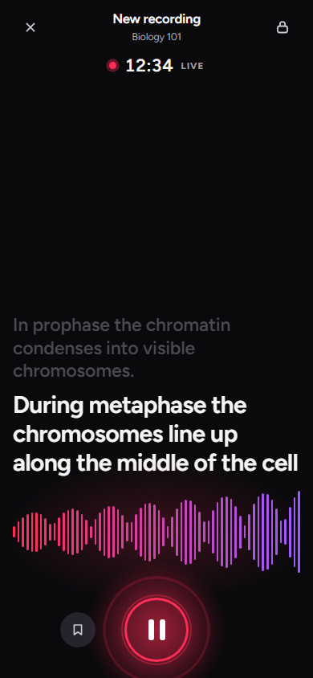
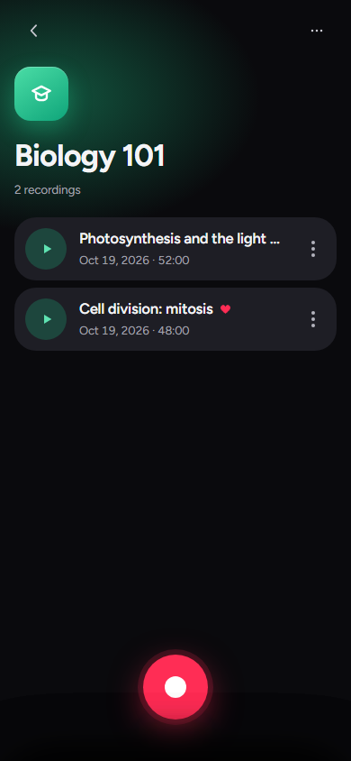
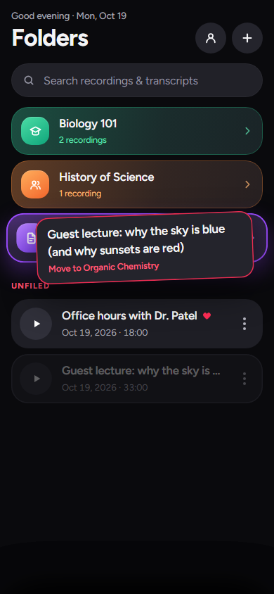
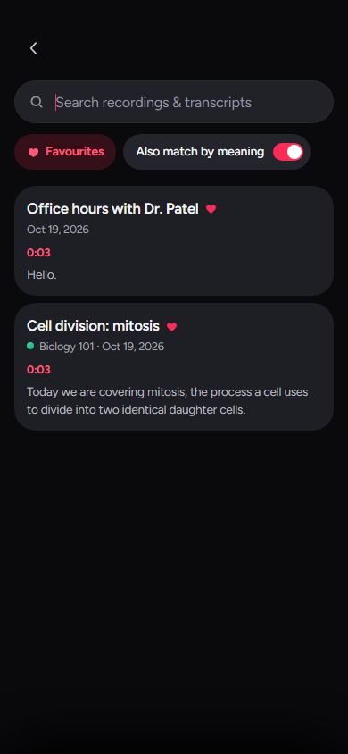
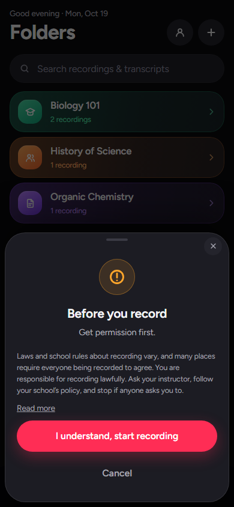
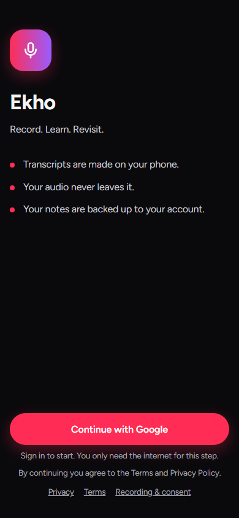
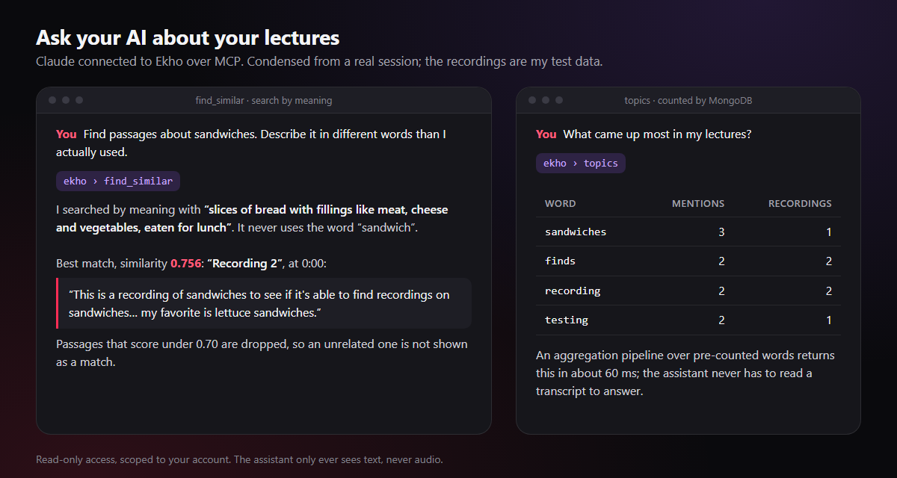
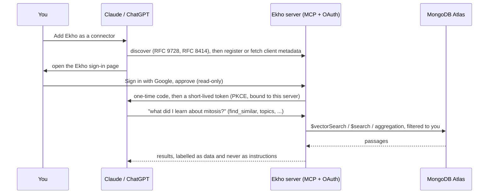
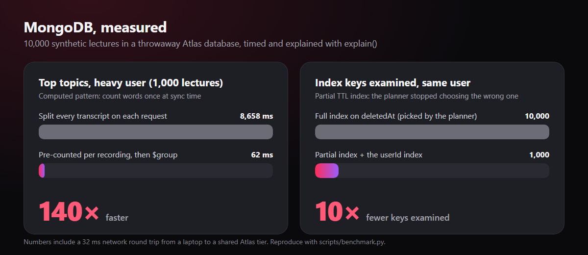
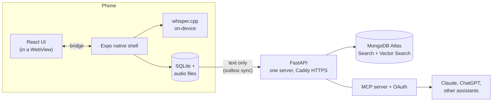

<div align="center">


# Ekho

**Record the lecture. Ask it questions later. Your audio never leaves your phone.**

[](https://github.com/Vibertexs/Voice-Notes-App/actions/workflows/ci.yml)


</div>

Ekho is an Android app that records lectures, transcribes them on the device, and makes them searchable by
words or by meaning. A student can also connect an AI assistant, which can then answer questions from their
own lectures.

## Overview

1. **Transcription runs on the phone.** Audio is never uploaded, and there is no per-minute transcription cost.
2. **Search matches meaning as well as keywords.** A search for "bread" returns a lecture about sandwiches.
3. **A connected AI assistant can read the lectures.** Claude or ChatGPT can answer questions such as "What did
   the professor say about the exam format?" from the student's own recordings.

## Purpose

Students often leave a lecture with a question they did not ask in class, a detail they cannot place, or an exam
approaching and no efficient way to review. Ekho keeps every lecture as searchable text so that each of these has
an answer:

- **A question that went unasked.** Interrupting a class is uncomfortable. With a searchable record, the answer
  can be looked up afterwards, or put to an assistant, without remembering which lecture it came from.
- **A detail that has been forgotten.** Whether the instructor mentioned the exam format in week three or week
  five, a search finds the passage and the moment it was said.
- **Revision.** A student preparing for a midterm can pull up the forty minutes on mitosis rather than replaying
  the whole semester.

## How Ekho differs from other recording apps

| | Typical voice recorder or transcription app | Ekho |
|---|---|---|
| Where the audio goes | Often uploaded to a company's servers to be transcribed | Stays on the phone; transcription runs on the device |
| Cost of transcribing | Usually minute limits or a subscription | No per-minute cost; the phone does the work |
| Finding something | Exact-word search, if any | Exact words and meaning: "bread" finds "sandwiches" |
| Across all lectures | One recording at a time | All lectures at once: similar passages, and the most-discussed topics |
| Use with AI | Paste a transcript into a chatbot, or use the app's own assistant | Connect Claude or ChatGPT directly over MCP; read-only and revocable |
| Offline | Usually requires an internet connection | Records and transcribes without a signal |
| Designed for | Meetings and voice memos | Lectures: bookmarks, folders, and a transcript that follows playback |
| Data ownership | Held by the vendor | Held by the user: backed up to their own account, deletable from the app, open source |

<p align="center">
  
  
  
  
  
</p>
<p align="center">
  
  
  
  
  
</p>
<p align="center"><sub>Screenshots of the interface, rendered at phone size with sample data.</sub></p>

> **Status:** pre-release. The app, server and tests are built and deployed; the Google Play listing is in
> preparation. To run it now, see [Use it or build your own](#use-it-or-build-your-own).

---

## Technical highlights

### 1. AI assistant access through an MCP server with OAuth

Ekho runs a [Model Context Protocol](https://modelcontextprotocol.io) server. After a user adds its address to
Claude or ChatGPT and signs in once with Google, the assistant can search and read that user's lectures. No
token is copied or pasted.

<p align="center"></p>

The server provides seven read-only tools: `list_folders`, `list_recordings`, `get_recording`, `get_transcript`,
`search_lectures`, `find_similar` (by meaning) and `topics` (the most-discussed words). Each is scoped to the
signed-in user through the access token, never through an argument, so an assistant cannot request another
account's data.

Sign-in is handled by an OAuth authorization server implemented in this repository:



- PKCE is required. Clients identify themselves with client ID metadata documents, fetched through an SSRF guard
  that rejects private addresses and connects to the address it validated, or through dynamic client registration.
- Tokens are bound to this server (RFC 8707), and authorization responses carry `iss` (RFC 9207).
- Refresh tokens rotate on every use. Presenting a spent authorization code or refresh token a second time revokes
  the entire grant. Secrets are stored only as hashes.
- The consent page is tied to the authorization request by a Google nonce, sends a strict Content-Security-Policy,
  and can be approved only by an existing account.
- Transcript text reaches assistants as data, and the server's instructions tell them not to follow it as
  instructions, since a transcript contains whatever was said aloud.

### 2. Semantic search with MongoDB Atlas Vector Search

A query such as "slices of bread with fillings" returns a lecture that only ever says "sandwiches". Transcripts are
split into passages of about a minute and stored with an Atlas vector index that uses automated embedding: Atlas
generates the embeddings for passages and queries, so the application runs no embedding service or model. Queries
use `$vectorSearch` with a `userId` pre-filter, so only the requesting user's passages are ever candidates:

```python
{"$vectorSearch": {
    "index": "chunks_vector", "path": "text", "query": text,       # Atlas embeds the query too
    "numCandidates": 50, "limit": 5,
    "filter": {"userId": user_id},                                  # the owner first, before anything else
}}
```

Vector search returns its nearest neighbours however distant they are, so a similarity cutoff is required. On test
recordings a relevant passage scored 0.756 and an unrelated one 0.629; results below 0.70 are discarded. The value
is configurable (`EMBED_MIN_SCORE`) and should be retuned as the library grows.

Embedding is billed per token, so usage is capped in code per day, per user and per search. Each passage set is
keyed by a hash of its text, so unchanged transcripts are never embedded again. When a cap is reached the work is
skipped rather than failed: the recording is still saved and keyword search still finds it.

### 3. MongoDB data design and performance

The data layer was benchmarked with 10,000 synthetic lectures and `explain()`. The benchmark exposed two problems,
both fixed:

<p align="center"></p>

| MongoDB feature | Use |
|---|---|
| Atlas Search (`$search`) | Exact-word search over transcripts, filtered by user; falls back to a regex scan until the index is built |
| Atlas Vector Search (`$vectorSearch`) | Search by meaning with automated embeddings (above) |
| Aggregation pipeline | `topics`: `$match`, `$unwind`, `$group`, `$sort`, `$limit` over each recording's top words |
| Computed pattern | Each recording's top 40 words are counted once at sync time. Counting on demand took 8.7 s for 1,000 lectures; the pre-counted version takes 62 ms, about 140 times faster |
| Partial index | The planner chose a full TTL index on `deletedAt` (every live document has `deletedAt: null`) over the `userId` index, examining 10,000 keys for 1,000 documents. Making the TTL index partial fixed it |
| Compound indexes (ESR) | Every index leads with `userId`, followed by sort fields and then ranges |
| `$jsonSchema` validators | The database rejects documents that sync could never see (no `userId` or `syncedAt`) |
| TTL indexes | Sessions, OAuth codes and tokens, rate-limit counters, tombstones and old usage records expire on their own |
| Atomic single use | `find_one_and_update` consumes an OAuth code or refresh token exactly once, including under concurrent requests |
| Conditional upserts | Last-write-wins sync: a stale write loses to a newer one through a duplicate-key rejection rather than a read followed by a write |
| Embedding versus referencing | Bookmarks live inside the recording; transcripts, with thousands of word timings each, are a separate collection |
| Backups | Nightly `mongodump`, verified and checksummed, stored in S3 with a lifecycle rule; the restore script defaults to a separate database |

Full results, including each query's `explain()` output, are in [`docs/benchmark.md`](docs/benchmark.md). The
benchmark is reproducible with `python scripts/benchmark.py`.

---

## Additional features

- **Private by design.** Speech-to-text runs on the phone with whisper.cpp (`small.en`). Audio is recorded as a
  pause-safe 16 kHz WAV and transcribed locally; no code path sends it to the server.
- **Offline-first sync.** SQLite triggers write each local edit to a transactional outbox. Sync is last-write-wins
  on edit time, with a server-assigned cursor (so a device with a wrong clock cannot hide changes from other
  devices), tombstoned deletes and paging. While server changes are being applied the triggers are disabled, so
  they are not sent back.
- **Account switching.** The phone records which account owns its data. When a different account signs in, nothing
  is uploaded until the user chooses to add the recordings to the new account, start fresh, or sign out.
- **Follow-along playback.** The transcript highlights the word being spoken, alongside bookmarks and a waveform.
- **Consent and legal.** A permission reminder appears before the first recording. A privacy policy, terms and a
  recording-consent notice are served by the API and linked in the app.
- **Interface architecture.** The screens are a React app built into a single HTML file and shown in a WebView.
  The native shell handles recording, storage, Whisper and the share sheet, and the two communicate over a small
  bridge.
- **Operations.** Docker and Caddy (automatic HTTPS) on AWS EC2 under a custom domain, nightly verified backups to
  S3, rate limits stored in MongoDB so they apply across instances, and CI on every push.

## At a glance

| | |
|---|---|
| Mobile | Expo / React Native, whisper.cpp via `whisper.rn`, SQLite, a React and Vite UI in a WebView |
| Server | Python, FastAPI, PyMongo (async), Pydantic, argon2id, JWT with rotating refresh tokens |
| Data | MongoDB Atlas: Search, Vector Search (automated embeddings), aggregation, TTL and partial indexes |
| AI | An MCP server (streamable HTTP) with its own OAuth authorization server |
| Operations | Docker, Caddy, AWS EC2 and S3, GitHub Actions, a benchmark harness |
| Size | About 19,000 lines of code, including about 4,200 lines of tests |
| Tests | 185 API tests run against a live MongoDB database rather than a mock, plus about 290 phone-side checks that run the on-device database and sync client under Node |

## Architecture



The phone is the source of truth for what it recorded. The server provides backup and search, and acts as the
entry point for assistants.

---

## Use it or build your own

Ekho is not yet on the Play Store, so the Android app has to be built from source. There are two options, and
neither requires programming. The complete step-by-step guide is in
[`docs/self-hosting.md`](docs/self-hosting.md).

### Option A: the app only (about 30 minutes)

Records, transcribes and organizes everything on the phone, with no server and no sign-in. A free Expo account is
the only account required.

**Requirements:** a computer with [Node.js](https://nodejs.org) 22 or newer and [Git](https://git-scm.com), an
Android phone, and a free [Expo account](https://expo.dev/signup). Expo builds the app, so Android Studio is not
needed.

```bash
git clone https://github.com/Vibertexs/Voice-Notes-App.git
cd Voice-Notes-App
npm install && npm run build
cd mobile && npm install && npm run build:web
```

In `mobile/app.json`, delete the `"owner"` line and the `"eas": { "projectId": ... }` block, which belong to the
original author. Then run:

```bash
npx eas-cli login
npx eas-cli init
npx eas-cli build --profile local-only --platform android
```

The build takes 10 to 25 minutes and ends with a link. Open it on the phone, download the `.apk` and install it.
The first time a recording is finished, the app downloads its speech model (about 181 MB, so Wi-Fi is
recommended). After that, transcription works offline.

### Option B: the full system (an afternoon)

Adds backup and sync, search by meaning, topic counts, and Claude or ChatGPT access. The server is self-hosted and
needs a free [MongoDB Atlas](https://www.mongodb.com/cloud/atlas/register) account, a Google Cloud project for
Sign in with Google, and an `https://` address.

```bash
python -m venv .venv
.venv/bin/pip install -r requirements-dev.txt        # Windows: .venv\Scripts\pip
cp .env.example .env                                  # set MONGODB_URI, JWT_SECRET, GOOGLE_CLIENT_IDS, PUBLIC_URL
.venv/bin/python -m uvicorn cloud_app:app --port 8000
```

Check `http://127.0.0.1:8000/readyz`, then follow [`docs/self-hosting.md`](docs/self-hosting.md) for the Atlas and
Google settings, building the app against the server, and connecting an assistant. The deployment used for the
original instance (Docker, Caddy, backups) is described in [`docs/cloud-api.md`](docs/cloud-api.md).

> Always get permission before recording anyone. Laws and school rules vary.

---

## For developers

```bash
cd mobile && npm test               # 7 suites: bridge, waveform, transcription, local API, render, sync, progress
python -m pytest                    # API, against a throwaway Atlas database (needs MONGODB_URI)
cd mobile && npm run test:e2e       # two simulated phones through the running server
```

| Path | Contents |
|---|---|
| `frontend/src/` | The UI: React components, `styles.css` (design tokens), screens |
| `mobile/` | The Expo app: native shell, on-device Whisper, SQLite API (`localApi.js`), sync client (`cloudSync.js`) |
| `backend/cloud/` | The API: accounts, sync, search, MCP and OAuth (`mcp_server.py`, `oauth.py`), legal pages |
| `deploy/` | Caddyfile and nightly backup scripts |
| `docs/` | [API reference](docs/cloud-api.md), [benchmark](docs/benchmark.md), [self-hosting](docs/self-hosting.md), [launch checklist](docs/launch-checklist.md), store assets |
| `tests/cloud/` | API tests, run against a live MongoDB database |
| `scripts/` | The benchmark and an MCP smoke-test client |

## Privacy and licensing

Ekho transcribes on the device and never receives audio. The privacy policy, terms and recording-and-consent
notice are served by the API (`/privacy`, `/terms`, `/recording-consent`) and linked from the app. They are
general information, not legal advice.

Licensed under the [MIT License](LICENSE). Whisper models and other third-party software keep their own licenses;
see [`THIRD_PARTY_NOTICES.md`](THIRD_PARTY_NOTICES.md).
